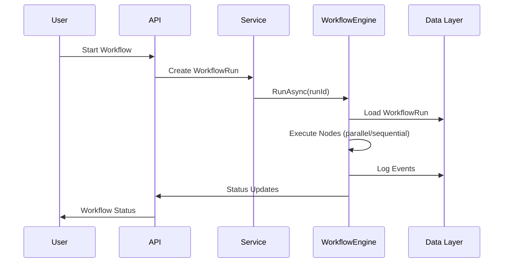

## Enterprise‑Grade Backend for Agentic URL Shortener
#### Built with C#/.NET, SQL Server, and an Agentic SDLC Orchestration Engine. 

## Solution Structure

    UrlShortener.Backend/
     ├── UrlShortener.Api/            → API layer (controllers, DI composition root)
     ├── UrlShortener.Domain/         → Entities + Interfaces (pure business)
     ├── UrlShortener.Data/           → Dapper repositories + SQL scripts
     ├── UrlShortener.Service/        → Business services (optional but recommended)
     ├── UrlShortener.Tests/          → Unit + integration tests
     ├── UrlShortener.Workflow.Orchestration/  → Workflow
 ### Swagger UI:** **https://localhost:7138/swagger/index.html**    

## This backend provides:

-   A clean, modular **URL Shortener API**
    
-   Analytics tracking (UrlHits)
    
-   A full **Agentic SDLC Workflow Engine** with:
    
    -   Dependency graph execution
        
    -   Parallel execution
        
    -   Human approvals
        
    -   Retry + rollback
        
    -   Pause / resume / cancel
        
    -   Auto dynamic re‑planning

## 📐 Layered Architecture Diagram
```mermaid
flowchart TD
    A[API Layer<br/>Controllers] --> B[Service Layer<br/>Business Services]
    B --> C[Workflow Orchestration Layer<br/>WorkflowEngine]
    C --> D[Data Layer<br/>Repositories]
    D --> E[Domain Layer<br/>Entities & Models]
 ```
## 🧱 Clean Architecture Principles
> **Note:** Controllers never call repositories directly. They call **services**, which call **repositories**.

> **Warning:** WorkflowEngine is infrastructure — it may call repositories directly.

## 🔗 URL Shortener API
URL Domain Model + Basic Shortener API
**POST /api/urls** - Creates a short URL.

**Request**

    {  "longUrl":  "https://example.com"  }
**Response**
	

    {  
    "id":  "guid",  
    "code":  "abc12345",  
    "shortUrl":  
    "http://localhost:5000/abc12345",  
    "longUrl":  "https://example.com"  
    }
    
 ### GET /{code}**
Redirects to the long URL.
#### Example
    GET http://localhost:5000/abc12345
    → 302 Redirect to https://example.com
## 📊 **Step D — Analytics (UrlHits)**

 ✔ Added

-   `UrlHits` table (Check Schema.cs file for all Table Sql)
    
-   Dapper hit repository
    
-   Redirect endpoint logs each click
    
-   New analytics endpoint

### GET /api/urls/{id}/stats

    {
      "id": "guid",
      "code": "abc12345",
      "longUrl": "https://example.com",
      "totalHits": 12,
      "lastAccessed": "2026-10-16T14:22:11Z",
      "hits": [
        {
          "timestamp": "2026-10-16T14:22:11Z",
          "userAgent": "Mozilla/5.0",
          "ipHash": "base64hash"
        }
      ]
    }

## 🔄 **Workflow Engine (Agentic SDLC)**

### 📘 SDLC Workflow Graph
```mermaid
flowchart TD
    A[requirements] --> B[design<br/>(approval)]
    B --> C[implementation]
    C --> D[unit-tests]
    C --> E[integration-tests]
    D --> F[documentation]
    E --> F[documentation]

```

### ⚙️ Workflow Engine Features

#### ✔ Dependency graph execution

#### ✔ Parallel execution

#### ✔ Human approval gates

#### ✔ Retry + rollback

#### ✔ Pause / resume / cancel

#### ✔ Auto dynamic re‑planning

### 🔁 **Data Flow**



## ▶️ **Steps to Run the Application**

### 🟦 Prerequisites

-   .NET 8 SDK
    
-   SQL Server
    
-   Visual Studio / VS Code
    

### 🟦 1. Clone the repository

bash

```
git clone https://github.com/your-repo/urlshortener-agentic-sdlc.git
cd urlshortener-agentic-sdlc

```

### 🟦 2. Configure the database

Update `appsettings.json`:

json

```
{
  "ConnectionStrings": {
    "DefaultConnection": "Server=.;Database=UrlShortener;Trusted_Connection=True;"
  }
}

```

### 🟦 3. Build the solution

bash

```
dotnet build

```

### 🟦 4. Run the API

bash

```
dotnet run --project UrlShortener.Api

```

API starts at:

Code

```
https://localhost:7138
https://localhost:5001
http://localhost:5000

```

### 🟦 5. Start a workflow

bash

```
POST /workflow/start/sdlc

```

### 🟦 6. Pause / Resume / Cancel

bash

```
POST /workflow/{id}/pause
POST /workflow/{id}/resume
POST /workflow/{id}/cancel

```

### 🟦 7. Approve a node

bash

```
POST /workflow/{id}/approve/{nodeId}

```

## 📦 **Collapsible Section: SDLC Node Descriptions**

<details> <summary>Click to expand</summary>

-   **requirements** — Parse initial requirements
    
-   **design** — Generate design (requires approval)
    
-   **implementation** — Generate code
    
-   **unit-tests** — Run unit tests
    
-   **integration-tests** — Run integration tests
    
-   **documentation** — Generate documentation
    

</details>

## 🔥 **Conclusion**

This backend demonstrates how a traditional API can be enhanced with a **modern agentic SDLC orchestration engine**, featuring:

-   Clean architecture
    
-   Workflow automation
    
-   Parallel execution
    
-   Human approvals
    
-   Retry + rollback
    
-   Pause / resume / cancel
    
-   Auto dynamic re‑planning
    

It is a strong foundation for building **AI‑assisted engineering systems**.

    


